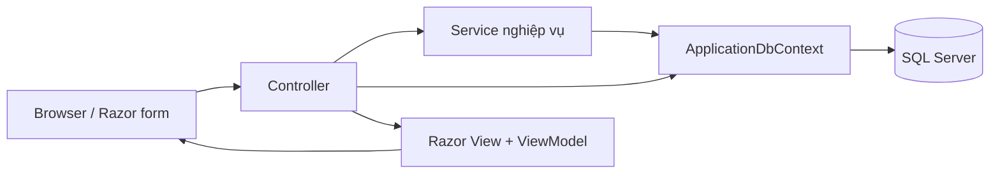

# ARCHITECTURE

Mốc rà soát: 24/10/2026, `89a068d` trên `main`. Đọc cùng [PROJECT_OVERVIEW](PROJECT_OVERVIEW.md), [DATABASE](DATABASE.md), [FEATURE_INVENTORY](FEATURE_INVENTORY.md).

## Cấu trúc thực tế

```text
ClinicManagementSystem.slnx       # chỉ chứa web project
ClinicManagementSystem.Web/
  Program.cs                     # composition root, auth, route, seed
  Controllers/                   # MVC actions + một số truy cập DB trực tiếp
  Services/                      # nghiệp vụ, đọc import, helper
  Models/Entities/               # entity nghiệp vụ
  Models/Identity/               # ApplicationUser
  Models/ViewModels/             # form, list, import, display
  Models/Binding/, Validation/   # binder ngày/số và số lượng nguyên
  Data/ApplicationDbContext.cs
  Data/Configurations/           # Fluent API sản phẩm/nhóm
  Data/Seeders/IdentitySeeder.cs
  Data/DevelopmentLocalDbConnection.cs
  Data/vietnam-addresses.*        # danh mục hành chính tĩnh + nguồn
  Migrations/                    # migration + Designer + snapshot
  Views/                         # Razor, chia theo tên controller thực tế
  wwwroot/js/, css/, lib/         # code client và vendor đóng gói
  Properties/launchSettings.json
  appsettings*.json
  dotnet-tools.json
  Chay-PhongKham.cmd, startmvc.vbs
 tests/                          # 3 console project + Node tests, ngoài solution
 docs/                           # bàn giao, SQL cập nhật, hướng dẫn triển khai cũ
```

Đây là **modular monolith MVC trong một assembly**, không phải Clean Architecture nhiều project. `Repositories` chỉ có khai báo Folder trong csproj; không có lớp repository đang được sử dụng. Không thêm UnitOfWork/repository/API layer mới chỉ để đồng nhất sơ đồ.

Lưu ý định vị: file `Controllers/ProductController.cs` chứa **ProductsController**; `PatientController.cs` chứa **PatientsController**; `SaleController.cs` chứa **SalesController**. Interface kho nằm ở file gõ thiếu chữ `Services/IIventoryService.cs`, kiểu thực là `IInventoryService`. Entity kho dùng namespace `ClinicManagementSystem.Web.Entities`, nhiều entity khác dùng `.Models.Entities`; ViewModel kho cũng có hai namespace. Đừng tạo kiểu trùng vì tìm theo tên file không ra.

## Luồng request và ranh giới



- Luồng phổ biến: binder + DataAnnotations → controller kiểm ModelState/quyền → service kiểm nghiệp vụ → EF Core → SQL Server → redirect hoặc render lại form cùng lỗi.
- **Ngoại lệ có chủ đích đang tồn tại:** InventoryController truy vấn Receipts/Transactions, MarkPaid, DeleteReceipt; ProductsController truy vấn History và các options; UserManagementController dùng UserManager trực tiếp. Không viết tài liệu như thể mọi thao tác đều bắt buộc đi qua service.
- JSON endpoints phục vụ lấy giá, tra SĐT trùng, tỉnh/xã; không thấy REST API độc lập hoặc SPA.
- `AsNoTracking` cho phần lớn truy vấn đọc. `ExecuteUpdateAsync`/`ExecuteDeleteAsync` bỏ qua change tracker; phải lưu ý entity đang track có thể cũ, test thường gọi `ChangeTracker.Clear()`.
- Thay đổi trạng thái quan trọng có transaction, nhưng mức isolation không đồng nhất; xem quy tắc dưới đây.

## Composition root và DI

Nguồn đăng ký duy nhất được xác nhận: `Program.cs`.

| Lifetime | Thành phần |
|---|---|
| Scoped | ApplicationDbContext qua AddDbContext/UseSqlServer |
| Scoped | IDashboardService → DashboardService; IProductCategoryService → ProductCategoryService; IProductService → ProductService; IInventoryService → InventoryService; IPatientService → PatientService; ISaleService → SaleService |
| Scoped | KiotVietCustomerReader, KiotVietProductReader, KiotVietSaleReader; PatientImportService, ProductImportService, SaleImportService; AppointmentService |
| Singleton | VietnamAddressService |
| Framework | Identity managers/stores/token providers, IMemoryCache, MVC |

Preview import được giữ trong bộ nhớ theo token + chủ sở hữu, khóa `SemaphoreSlim`. Khởi động lại app làm mất preview; triển khai nhiều instance chưa có distributed cache/lock trong source.

Startup tạo host, cấu hình services, build, **seed roles và Admin nếu được cấu hình**, sau đó middleware. Không có `Database.Migrate()` tự chạy. Chỉ chạy ứng dụng để kiểm tra kết nối có thể tạo roles/tài khoản; không dùng cách này cho yêu cầu chỉ đọc DB.

## Authentication / Authorization

- Global MVC AuthorizeFilter yêu cầu đăng nhập. Account Login và AccessDenied có AllowAnonymous; logout là POST.
- Identity có hai role do seed: `Admin`, `Staff`. Không có user registration công khai.
- Login tìm bằng email, kiểm IsActive, `PasswordSignInAsync` có lockout; returnUrl chỉ chấp nhận URL local.
- Mật khẩu: tối thiểu 8 ký tự, yêu cầu số/chữ thường/chữ hoa/ký tự đặc biệt; khóa 15 phút sau 5 lần thất bại.
- Cookie HttpOnly, hết hạn 8 giờ, sliding expiration; SecurePolicy phụ thuộc `Hosting:AllowHttp`. SecurityStampValidator kiểm mỗi request (`ValidationInterval=Zero`); đổi quyền/khóa tài khoản cập nhật stamp.
- Admin tự đổi mật khẩu; admin quản lý tài khoản khác nhưng không xóa Admin hoặc chính mình, không khóa/hạ quyền Admin hoạt động cuối cùng.
- POST thay đổi dữ liệu sử dụng ValidateAntiForgeryToken ở các action nghiệp vụ. Không thay thế bảo vệ phía server bằng việc ẩn nút UI.

| Nhóm action | Quyền được khai báo trong source |
|---|---|
| Quản lý tài khoản; đổi mật khẩu; sửa/tạo/xóa/toggle sản phẩm/nhóm; import sản phẩm; xem audit; kiểm kho; MarkPaid/DeleteReceipt | Admin |
| Dashboard và Appointments | Admin,Staff; Dashboard.Index chuyển Staff sang Revenue |
| Xóa hóa đơn | Admin,Staff; Staff được service/controller giới hạn chỉ Draft |
| Bệnh nhân, import bệnh nhân, xem sản phẩm/nhóm, nhập/xuất kho thủ công, xem phiếu kho, hóa đơn tạo/sửa/xác nhận/in, import hóa đơn | Global yêu cầu đăng nhập; không có Authorize role riêng trên các action này |
| Tạo bổ sung sản phẩm còn thiếu khi import hóa đơn | Controller truyền `User.IsInRole("Admin")` vào SaleImportService để chặn Staff |

Không suy ra tài khoản không thuộc role nào bị chặn mọi chức năng: nhiều action chỉ có global authenticated. Quyền vận hành mong muốn ngoài hai role trên: **Chưa xác minh**.

## Các quy tắc nghiệp vụ phải giữ

### Hóa đơn và doanh thu

- Create luôn lưu `Draft`, `SaleDate=null`, có CreatedAt riêng; nháp không trừ tồn, không cộng doanh thu. Create vẫn kiểm đủ tồn tại thời điểm tạo; UpdateDraft không gọi ValidateStockAsync.
- Confirm chỉ nhận Draft có dòng hàng. Trong transaction Serializable: cập nhật trạng thái có điều kiện, gán SaleDate theo **giờ Việt Nam khi xác nhận**, kiểm tồn, trừ kho có điều kiện, lập StockOut tham chiếu SaleCode và PatientId. Lỗi thì rollback cả ngày/trạng thái/tồn. Xác nhận lại không được tạo xuất kho lần hai.
- Dịch vụ không trừ kho. Combo không có tồn độc lập: tách thành các thành phần, cộng nhu cầu từ combo và hàng bán lẻ trước khi kiểm/trừ.
- Giá và tổng được tính ở server. Hàng mới lấy giá danh mục; dòng sao chép/sửa đã có SourceDetailId hợp lệ giữ đơn giá và thành tiền cũ nếu không đổi số lượng. Giảm Amount/Percent, giới hạn %, không giảm vượt tiền hàng; làm tròn 2 số bằng AwayFromZero.
- Chỉ Draft được Edit. Copy tạo nháp mới; không sửa hóa đơn nguồn, không trừ kho khi mở copy.
- Dashboard chỉ cộng Confirmed theo SaleDate. Tổng mua bệnh nhân = LegacyTotalSales + Confirmed hiện tại; Imported không cộng lại tổng cũ.
- Admin xóa Confirmed phải hoàn đúng **phiếu xuất gốc**, không tính theo cấu hình combo hiện tại; thiếu/không rõ phiếu gốc thì từ chối. Xóa Imported/nháp không hoàn kho. Xóa invoice hủy các lịch Pending gắn invoice; FK lịch đặt SaleId thành null, giữ thông tin lịch.

### Kho và sản phẩm

- Số lượng luồng nghiệp vụ là số nguyên; DB vẫn lưu decimal để tương thích dữ liệu/precision. Không đổi sang float/double.
- Nhập kho cộng CurrentStock và cập nhật CostPrice bằng đơn giá dòng nhập (không bình quân giá vốn). Xuất thủ công kiểm tổng số lượng khi lặp sản phẩm, giá trên phiếu lấy CostPrice.
- Kiểm kho chỉ xử lý các dòng có CountedStock; bỏ trống là chưa kiểm, số 0 là tồn thực tế bằng 0. Kiểm ExpectedStock và update có điều kiện để chống ghi đè; chỉ lưu phiếu Adjustment nếu có lệch.
- MarkPaid chỉ Admin, StockIn chưa thanh toán. DeleteReceipt chỉ Admin, StockIn đã thanh toán; xóa chi tiết rồi phiếu trong Serializable, **không thay đổi tồn**. Đây không phải nghiệp vụ hủy nhập hàng.
- ProductService cấm vừa combo vừa service; combo 1–100 thành phần, không chứa chính nó/combo/service, không trùng thành phần, số lượng nguyên dương. Một số chuyển đổi loại bị chặn nếu còn tồn hoặc đang là thành phần combo.
- ProductEditHistory ghi chênh lệch scalar (bỏ timestamps) và thành phần combo trong UpdateAsync; actor do controller lấy từ claims. Lưu cùng transaction sửa sản phẩm. Không có FK tới sản phẩm/user để lịch sử không phụ thuộc bản ghi còn tồn tại. Không có cơ chế audit toàn bộ SaveChanges.

### Bệnh nhân / tái khám / import

- Mã mới `LT` + dãy số tối thiểu 6 chữ số, chỉ dựa trên mã LT hợp lệ; unique index PatientCode là lớp bảo vệ cuối.
- NormalizePhone bỏ khoảng trắng/dấu phân cách, đổi +84 sang 0; cho trùng SĐT khi xác nhận hồ sơ người thân và quan hệ hợp lệ. Không áp đặt unique phone trong DB.
- Tỉnh/xã chọn từ catalog tĩnh; controller kiểm xã thuộc tỉnh và tự lấy tên, không tin tên post từ client. Ngày sinh không tương lai; CCCD 12 chữ số khi nhập form.
- Một lịch tái khám cho mỗi SaleId khác null; chỉ Pending được sửa/chuyển sang Attended/Cancelled. RowVersion kiểm cạnh tranh, không chỉ dựa vào giao diện.
- Import là XLSX offline có preview/confirm, kiểm owner và token hết hạn (khách/sản phẩm 20 phút, invoice 30 phút). Bỏ qua mã đã tồn tại, kiểm lại khi confirm; không tự ghi đè dữ liệu cũ.
- Imported giữ các trường source, giá trị lịch sử và ngày từ file, không dùng ngày xác nhận nghiệp vụ bán hiện tại. Import bypass một số service CRUD: không khẳng định mọi validation form cũng áp dụng cho import.

## Thành phần dùng chung phải tìm trước khi bổ sung

| Thành phần | Hợp đồng sử dụng |
|---|---|
| ListPaging + `_ListPaging` | 10 dòng/trang, clamp trang, giữ query string; Sales có VM riêng; Appointments 20 dòng/trang |
| ListSorting + `_ListSort`, `_ListSortForm` | newest/oldest/name_asc/name_desc, tie-break theo ID |
| DatePeriod + `_DatePeriod` | today/yesterday/month/lastMonth/year/lastYear; cận `[start,end)`, mốc Việt Nam |
| QuantityModelBinder + WholeQuantity | Dấu thập phân invariant, không hiểu dấu chấm thành phân cách nghìn; kiểm số nguyên ở server |
| DayMonthYearDateBinder + birth-date.js | Ngày sinh dd/MM/yyyy hoặc ddMMyyyy; không áp dụng tùy tiện cho mọi DateOnly |
| search-picker.js | Tìm không dấu, chọn ID hợp lệ, hỗ trợ touch/keyboard; phải init cho dòng thêm động |
| sale-pricing.js / SalePricing.cs | Client preview và server quyết định tiền; giữ hai bên đồng bộ |
| quick-patient.js / QuickCreated | Tạo nhanh qua iframe; kiểm nguồn message; cập nhật lựa chọn bệnh nhân |
| shared-phone.js + PhoneMatches | Tra trùng điện thoại và xác nhận quan hệ |
| vietnam-address.js / VietnamAddressService | Catalog đóng gói, giữ/khôi phục lựa chọn và chống response cũ |
| stock-form.js / `_StockRows` | Thêm/xóa dòng nhập/xuất, đánh lại chỉ số Details để model binding |
| site.js | GET live filter 200ms, hủy request cũ, không thay results nếu phiên hết hạn |
| mobile-layout.js, CSS/layout shared | Bảng dạng card trên mobile, nhãn cột, dùng chung navigation |
| KiotVietSheetReader | Đọc XML/ZIP an toàn cho sheet; customer/product reader hiện vẫn có parser riêng, không giả định tất cả dùng chung |

Không đổi đồng loạt tên file/namespace/status/timezone để làm đẹp kiến trúc trong khi xử lý tính năng khác. Các thay đổi này có thể ảnh hưởng import, test, SQL lịch sử và deployment.

## Cập nhật 27/10/2026 — phạm vi sản phẩm

Danh sách thao tác sản phẩm/tồn/kiểm kho mặc định Active/ACTIVE. Lưu trữ là phạm vi Inactive/INACTIVE trên bảng Products hiện có, không phải entity/bảng riêng và không có global query filter. Chứng từ/lịch sử và các sản phẩm đã chọn khi mở hóa đơn vẫn đọc theo hợp đồng hiện tại của SaleService.

`ProductService.ToggleStatusAsync` được dùng riêng bởi POST ToggleStatus chỉ Admin: Serializable, cập nhật Status/UpdatedAt và ghi ProductEditHistory cùng transaction, actor từ claims. Bổ sung này mở rộng nguồn audit ngoài UpdateAsync; không tạo audit toàn hệ thống. Tách thao tác trạng thái để không ghi lại tồn/giá từ ViewModel cũ hoặc bị kiểm tra thành phần combo cản lưu trữ.

StockCount GET/POST chỉ Admin nhận `archived`; true chỉ liệt kê hàng thường lưu trữ còn tồn dương. POST vẫn dùng AdjustStockAsync hiện có, giữ ExpectedStock/update có điều kiện/rollback. Phạm vi danh sách không thay đổi quy tắc điều chỉnh tồn và không tự kích hoạt hàng. Chi tiết kiểm chứng/giới hạn xem FEATURE_INVENTORY, mục 27/10/2026.
