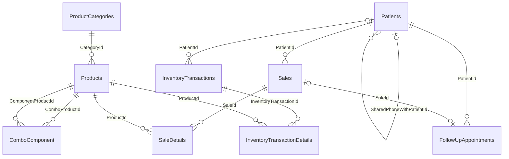

# DATABASE

Mốc source: **24/10/2026, `89a068d`**. Nguồn chuẩn để đối chiếu: `Data/ApplicationDbContext.cs`, `Data/Configurations/*.cs`, `Models/Entities/*.cs`, `Models/Identity/ApplicationUser.cs`, `Migrations/*` và `ApplicationDbContextModelSnapshot.cs` trong web project.

**Phạm vi xác minh:** schema mô tả dưới đây là schema theo source/snapshot, không phải bản dump từ máy chủ. Database đang chạy, phiên bản SQL Server, collation, bảng `__EFMigrationsHistory` thực tế, migration đã áp dụng, số bản ghi và backup gần nhất: **Chưa xác minh**. Không đọc dữ liệu bệnh nhân, không chạy update database trong lượt bàn giao.

## DbContext

`ApplicationDbContext : IdentityDbContext<ApplicationUser>`, provider `UseSqlServer`, lấy khóa cấu hình `ConnectionStrings:DefaultConnection`. Có 9 DbSet khai báo trực tiếp: ProductCategories, Products, ProductEditHistories, InventoryTransactions, InventoryTransactionDetails, Patients, FollowUpAppointments, Sales, SaleDetails. `ComboComponent` được đưa vào model qua quan hệ/Set<T> và có tên bảng **ComboComponent** (số ít), không có DbSet riêng. Bảng Identity do base context cấu hình.

Fluent configuration nhóm/sản phẩm được nạp bằng `ApplyConfigurationsFromAssembly`; phần còn lại chủ yếu trong OnModelCreating và DataAnnotations. Không có override SaveChanges hay interceptor audit tự động. Không có tự migrate lúc startup.

## Entities và thông tin được lưu

| Entity / bảng | Trường nghiệp vụ chính | Quan hệ và ghi chú |
|---|---|---|
| ProductCategory / ProductCategories | Id; Code(50), Name(200), Description(500), Status(20), **CreateAt**, **UpdateAt** | 1–n Product; tên timestamp không phải CreatedAt/UpdatedAt |
| Product / Products | Id; ProductCode(50), CategoryId, Name(200), Strength(100), DosageForm(100), Unit(50), Manufacturer(200); CostPrice, SellingPrice, MinimumStock, CurrentStock; IsCombo, IsService, KiotVietInfo(4000), Status(20), CreatedAt, UpdatedAt | Bắt buộc thuộc một nhóm; có các component nếu combo |
| ComboComponent / ComboComponent | ComboProductId, ComponentProductId, Quantity | PK ghép hai ID; hai FK tới Products |
| Patient / Patients | Id, PatientCode(30), FullName(200), DateOfBirth, CitizenIdNumber(12), CitizenIdIssueDate, Gender(20), PhoneNumber(20); SharedPhoneWithPatientId, SharedPhoneRelationship(50); Address(300), ProvinceCode/WardCode, ProvinceName/WardName(100); Occupation(100), Notes(500), LegacyTotalSales, LegacyImportedAt, Status(20), CreatedAt, UpdatedAt | Self-reference người thân dùng chung số; lưu tên địa chỉ để giữ lịch sử catalog |
| Sale / Sales | Id, SaleCode(50), PatientId, **SaleDate nullable**, Status(20), TotalAmount; ImportedGoodsTotal/Discount/Surcharge; SourcePatientName(200)/Code(30), ImportedFileName(255), ImportedAt, Notes(500), CreatedAt/UpdatedAt | Draft không có ngày bán; Confirmed có ngày xác nhận; Imported có ngày file; 1–n SaleDetail |
| SaleDetail / SaleDetails | Id, SaleId, ProductId, Quantity, UnitPrice, LineTotal, Notes(500), SourceProductCode(50)/Name(200)/Unit(50), KiotVietInfo(4000) | FK Sale/Product; source fields bảo toàn dữ liệu import/sao chép |
| InventoryTransaction / InventoryTransactions | Id, TransactionCode(50), TransactionType(20), TransactionDate, Reason(500), ReferenceNumber(100), CreatedBy(100), CreatedAt, PaidAt nullable, PaidBy(100), PatientId nullable | 1–n chi tiết; PatientId là FK; **ReferenceNumber là chuỗi, không phải FK Sale** |
| InventoryTransactionDetail / InventoryTransactionDetails | Id, InventoryTransactionId, ProductId, Quantity, UnitPrice, Note(300) | FK phiếu kho và sản phẩm; Quantity có thể âm ở Adjustment |
| FollowUpAppointment / FollowUpAppointments | Id, PatientId, SaleId nullable, SaleCode(50), MedicationDays, MedicationStartDate, AppointmentDate, UseCustomDate, Status(20), Notes(500), CreatedAtUtc/UpdatedAtUtc, CreatedBy/UpdatedBy(256), AttendedAtUtc/By(256), RowVersion | Gắn bệnh nhân và tùy chọn hóa đơn; rowversion 8 byte theo SQL Server |
| ProductEditHistory / ProductEditHistories | Id, ProductId, ProductCode(100), ProductName(500), ActorId(450), ActorName(256), ChangedAt, FieldName(100), OldValue, NewValue | Không có FK Product/User; scalar snapshot và chênh lệch, giữ lịch sử khi đối tượng bị xóa |
| ApplicationUser / AspNetUsers | IdentityUser (ID string) + FullName, IsActive, CreatedAt; entity không đặt MaxLength cho FullName | Vai trò tách ở AspNetUserRoles; không có FK từ ActorId/CreatedBy nghiệp vụ |

Bảng Identity khác: AspNetRoles, AspNetRoleClaims, AspNetUserClaims, AspNetUserLogins, AspNetUserRoles, AspNetUserTokens; cấu trúc/khóa theo migration AddIdentityAuthentication và model Identity. Email unique được yêu cầu ở Identity options; không đánh đồng với unique index trên EmailIndex.

## Sơ đồ quan hệ



Sơ đồ không vẽ một FK tưởng tượng giữa InventoryTransactions.ReferenceNumber và Sales.SaleCode hoặc ProductEditHistories.ProductId và Products.Id. Liên kết phiếu bán/hoàn kho dựa trên chuỗi SaleCode và Reason trong service/controller.

### DeleteBehavior

- Restrict: Product → Category; ComboComponent → ComponentProduct; Sale → Patient; SaleDetail → Sale/Product; InventoryTransaction → Patient; InventoryTransactionDetail → transaction/Product; Appointment → Patient; Patient → SharedPhoneWithPatient.
- Cascade: ComboComponent → ComboProduct; các bảng Identity phụ theo migration Identity.
- SetNull: Appointment → Sale. SaleCode snapshot vẫn giữ khi hóa đơn bị xóa.
- Service/controller phải xóa chi tiết trước khi xóa hóa đơn/phiếu kho. Không tự chuyển các FK Restrict sang Cascade để vượt lỗi xóa.

## Precision, indexes và check constraints

| Phạm vi | Cấu hình hiện tại |
|---|---|
| Product.CostPrice/SellingPrice/MinimumStock | decimal(18,2) |
| Product.CurrentStock | decimal(19,3) |
| ComboComponent.Quantity | decimal(18,2); CHECK Quantity > 0 |
| Patient.LegacyTotalSales | decimal(18,2) |
| Sale.TotalAmount/ImportedGoodsTotal/ImportedDiscount/ImportedSurcharge | decimal(18,2) |
| SaleDetail.Quantity; InventoryTransactionDetail.Quantity | decimal(18,3) |
| SaleDetail.UnitPrice/LineTotal; InventoryTransactionDetail.UnitPrice | decimal(18,2) |
| Unique indexes nghiệp vụ | Patient.PatientCode; Sale.SaleCode; InventoryTransaction.TransactionCode |
| Combo key | (ComboProductId, ComponentProductId) |
| Appointment | Unique SaleId với filter `[SaleId] IS NOT NULL`; index (AppointmentDate,Status,Id); index PatientId |
| Appointment CHECK | Status IN Pending/Attended/Cancelled; MedicationDays 1–3650; AppointmentDate >= MedicationStartDate |
| Audit index | (ProductId,ChangedAt,Id), không phải unique |
| ProductCode, category Code | **Không có unique index trong snapshot**; service kiểm trùng không thay thế bảo đảm DB |
| SĐT và CCCD bệnh nhân | Không có unique index được cấu hình |

Các giới hạn số lượng nguyên, không trùng dòng, giá không âm, combo không lồng nhau, quan hệ người thân và định dạng CCCD chủ yếu ở form/controller/service. DB không có CHECK tương ứng cho mọi bảng. Không được suy ra precision decimal bảo đảm số nguyên, hoặc mọi giá trị âm đều bị DB chặn.

## Danh sách migrations theo thứ tự

Mỗi mục có file `.cs` và `.Designer.cs`; snapshot mới nhất là `ApplicationDbContextModelSnapshot.cs`. Timestamp tên migration là ID lịch sử, không dùng để suy ra ngày triển khai thực tế.

| Migration ID | Nội dung Up được xác nhận |
|---|---|
| 20260910163454_InitialCreate | ProductCategories và Products, FK nhóm |
| 20261011052525_AddInventoryModule | Phiếu/chi tiết kho, unique mã phiếu; rename status của nhóm |
| 20261011130834_AddPatientManagement | Patients và unique PatientCode |
| 20261011132854_AddSalesManagement | Sales, SaleDetails, unique SaleCode và các FK |
| 20261011154254_AddIdentityAuthentication | Các bảng AspNet* và indexes Identity |
| 20261011183124_AddSaleDetailNotes | Ghi chú dòng hóa đơn |
| 20261012132136_AddPatientAdministrativeAddress | Mã/tên tỉnh và xã của bệnh nhân |
| 20261012135110_AddPatientLegacySales | Tổng bán cũ và thời gian import |
| 20261012142845_AddProductCombos | IsCombo, ComboComponent, PK ghép/FK/check Quantity |
| 20261012151123_AddKiotVietProductImport | Đổi precision CurrentStock; IsService; KiotVietInfo |
| 20261012155117_AddKiotVietInvoiceHistory | Header/line source fields, tổng hàng/giảm giá/thu khác và metadata import |
| 20261013172311_AddPatientSharedPhone | Liên kết người thân dùng chung SĐT và quan hệ |
| 20261016133150_AddPatientCitizenIdentity | CCCD/ngày cấp |
| 20261016135728_AddFollowUpAppointments | Bảng lịch tái khám, rowversion, indexes và check constraints |
| 20261018161818_AddInventoryPaymentAndPatient | PaidAt/PaidBy, PatientId FK cho phiếu kho; backfill PatientId từ hóa đơn theo mã phiếu xuất bán |
| 20261023173429_AddProductEditHistoryAndDraftSaleDate | SaleDate nullable; null hóa ngày của Draft; sửa ngày Confirmed bằng MIN(TransactionDate) của phiếu StockOut có Reason xuất bán; tạo ProductEditHistories |

**Migration cuối có sửa dữ liệu**, không chỉ tạo bảng. Confirmed không còn phiếu xuất khớp sẽ không được backfill. Imported giữ ngày từ file. Down của migration cuối điền CreatedAt cho SaleDate null rồi bỏ bảng audit/đổi nullability: rollback mất lịch sử audit và không khôi phục nguyên vẹn ngày bán cũ. Phải backup trước khi chạy.

`docs/UPDATE-INVENTORY-PAYMENT-PATIENT.sql` và `docs/UPDATE-PRODUCT-HISTORY-DRAFT-DATE.sql` là script cho các khoảng migration cụ thể. Không coi chúng là script khởi tạo đầy đủ hoặc luôn phù hợp DB đích; kiểm tra migration nguồn/đích và `__EFMigrationsHistory` trước khi dùng.

## Ngày giờ và trạng thái

- SaleDate khi confirm, ProductEditHistory.ChangedAt, khoảng lọc DatePeriod và dashboard dùng giờ Việt Nam (`SE Asia Standard Time`).
- Patient/Product CRUD và Identity thường dùng UTC timestamps; Appointments dùng trường `*Utc`, ngày lịch DateOnly theo Việt Nam.
- Nhập/xuất kho thủ công, kiểm kho, MarkPaid và nhiều timestamp hóa đơn dùng DateTime.Now. Không có cơ chế chuyển UTC thống nhất toàn ứng dụng. Múi giờ máy chủ thật: **Chưa xác minh**.
- Không đổi tất cả timestamps sang UTC bằng một migration hàng loạt nếu chưa phân loại dữ liệu hiện có.
- Status hiện là string, không phải enum DB: Active/ACTIVE và Inactive/INACTIVE cùng xuất hiện; Draft/Confirmed/Imported; Deleting chỉ dùng khóa tạm trong transaction xóa; StockIn/StockOut/Adjustment; Pending/Attended/Cancelled.

## Quy trình thay đổi database an toàn (cho lần phát triển sau)

1. Xác định đúng môi trường, instance, catalog, danh tính Windows/SQL và commit đang chạy bằng cấu hình riêng của máy. Không đưa connection string chứa bí mật vào Git/tài liệu/output.
2. Kiểm tra schema và `__EFMigrationsHistory` **chỉ đọc** trên đích; so với 16 migration trên source. Không giả định việc user đã chạy lệnh đồng nghĩa thành công.
3. Backup SQL đầy đủ, lưu ngoài thư mục publish/repository; kiểm tra restore vào DB thử nghiệm. Chủ sở hữu, retention, đường dẫn và lần restore gần nhất: **Chưa xác minh**.
4. Sửa entity/config đúng phạm vi; tạo **migration mới** bằng EF CLI. Không sửa/xóa/đổi tên migrations đã được chia sẻ hoặc áp dụng. Review cả Up, Down, Designer và snapshot.
5. Test trên DB thử nghiệm có dữ liệu tổng hợp: apply từ rỗng, nâng từ migration trước, kiểm FK/index/null/precision, dữ liệu backfill và luồng hồi quy. `EnsureCreated` của test không chứng minh chuỗi migrations hoạt động.
6. Sinh script để review bằng `dotnet ef migrations script --idempotent --project ClinicManagementSystem.Web --output <file.sql>`; công cụ dùng đúng cấu hình/phiên bản. Không chạy script tùy tiện trên Production.
7. Khi việc đổi schema đã nằm trong yêu cầu được giao, lên lịch dừng app/backup, áp dụng đúng DB và bản phát hành tương thích; xác nhận schema trước khi restart vì startup chạy seed Identity.
8. Sau triển khai, kiểm đăng nhập, tạo nháp/xác nhận, nhập/xuất/cân kho, import, tái khám và audit bằng dữ liệu thử được phép. Ghi kết quả không kèm thông tin người bệnh.

Ví dụ kiểm tra metadata trong SSMS trên **DB đã chọn đúng** (không chứa dữ liệu bệnh nhân):

```sql
SELECT MigrationId, ProductVersion FROM dbo.__EFMigrationsHistory ORDER BY MigrationId;
SELECT name FROM sys.tables ORDER BY name;
```

Lệnh update, chỉ chạy trong lần triển khai có phạm vi thay đổi DB đã được xác định:

```powershell
dotnet ef database update --project ClinicManagementSystem.Web
```

Lệnh này lấy cấu hình theo môi trường hiện tại; nó không tự biết máy Development/Production bạn định cập nhật. Không chạy ứng dụng để thăm dò schema, vì startup có thể seed roles/Admin.


## Cập nhật 28/10/2026 — thời gian nháp

Không đổi schema/migration/snapshot. Draft vẫn SaleDate=null, giao diện lấy CreatedAt hiện có; Confirmed/Imported lấy SaleDate. Nháp mới qua SaleService.CreateAsync lưu CreatedAt/UpdatedAt bằng giờ Việt Nam thay DateTime.Now. Nháp cũ dùng nguyên CreatedAt đã lưu, múi giờ lịch sử **Chưa xác minh**; không chạy backfill. Xác nhận vẫn ghi SaleDate và phiếu xuất cùng transaction.
